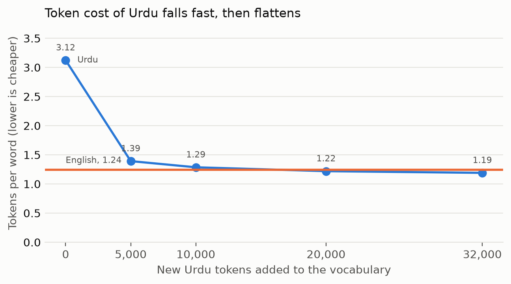
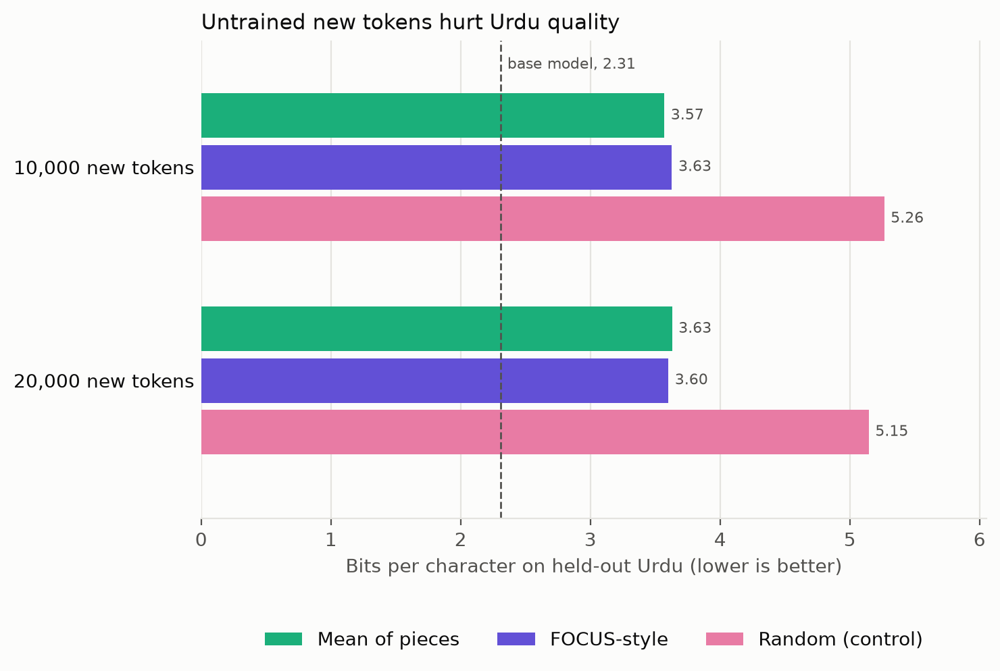
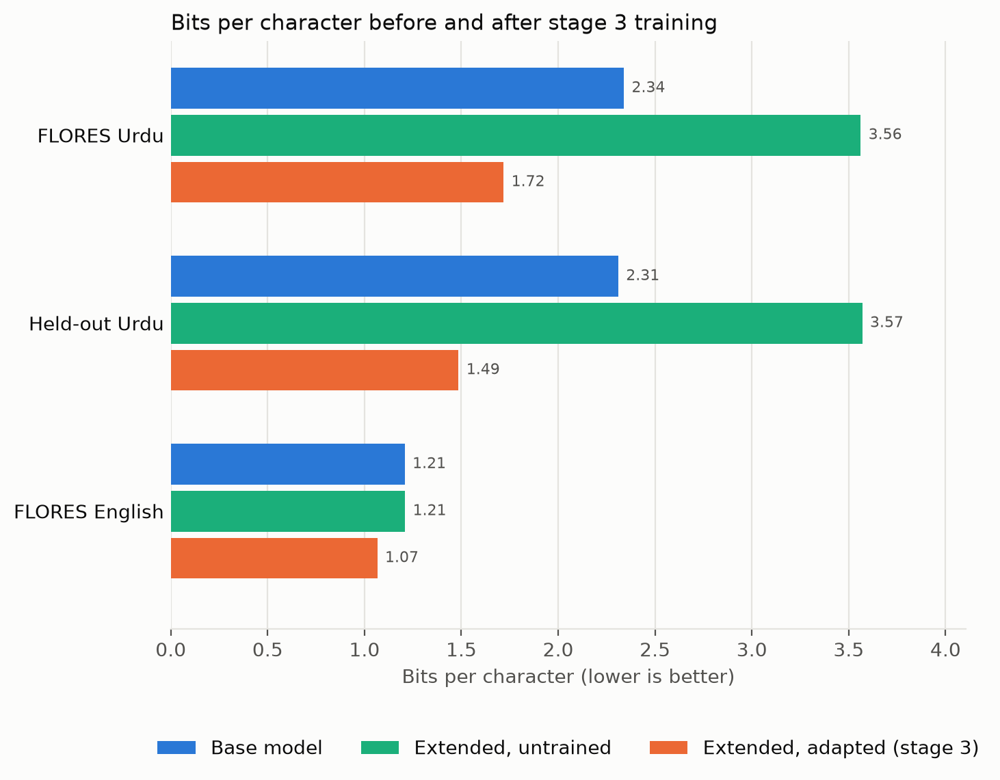

# Extending Qwen/Qwen3-1.7B with Urdu tokens

Two things were measured for each vocabulary size: what Urdu costs in tokens, and what it does to
quality. A cost saving is only a result if quality is shown next to it.

## Summary

- Adding 10,000 Urdu tokens cuts the cost of Urdu from **3.14x** to **1.29x** the tokens of the same English text (3.12 to 1.29 tokens per Urdu word). English tokenization is byte-for-byte unchanged and Urdu round-trips, at every size.
- The new embeddings are initialized, not trained, so Urdu quality is worse for now: bits per character on held-out Urdu goes from 2.31 (base) to 3.57 (`10,000` tokens, mean-of-pieces init), 55% higher. Stage 3 (continued pretraining) is what should close this gap.
- Belebele Urdu accuracy is 33.4% (30.4% to 36.6%) for the base model. Every extended variant scores between 24.9% and 27.0%, against a chance level of 25%.
- English is almost untouched: bits per character moves from 1.208 to between 1.210 and 1.214.
- GGUF export passes the tokenizer parity check: llama.cpp `b12477` and Hugging Face give identical token ids on 2,041 of 2,045 texts, and the other 4 differ only because the text is not in NFC form (see the GGUF section).
- After stage 3 training, the extended model needs **2.43x fewer tokens** for the same FLORES Urdu text and scores **0.62 fewer bits per character** than the base (2.339 to 1.718). Belebele Urdu is 34.0% against the base's 33.4%. Whether the gain comes from the new tokens or from the extra Urdu training is not yet known (see the stage 3 section).

## What was done

1. Merges were learned from Urdu Wikipedia on top of the base tokenization (continued BPE), and
   only merges that contain Arabic-script bytes are allowed, so English text cannot be affected.
2. The merges were appended to the base tokenizer as real BPE merges, not as added tokens. The
   base pre-tokenizer is unchanged, and special tokens keep their ids.
3. The embedding matrix (input and tied output head) was resized and each new row initialized
   one of three ways: **mean of pieces** (the mean of the embeddings of the base tokens the new
   token replaces), **FOCUS-style** (a sparsemax-weighted mean of similar old tokens, using
   co-occurrence vectors from the Urdu corpus; see `docs/decisions.md`) and **random** (a control:
   noise with the old rows' per-dimension mean and spread).
4. **Nothing was trained.** The new rows are only initialized.

## Token cost

Measured on FLORES-200 devtest, 1,012 parallel sentences (`urd_Arab` and `eng_Latn`), after Urdu
normalization. English tokens per word is 1.24 in
every row, because English tokenizes identically.



| New tokens | Vocabulary | Urdu tokens/word | Urdu chars/token | Cost multiplier | English changed | Round-trip failures |
| ---: | ---: | ---: | ---: | ---: | ---: | ---: |
| 0 | 151,669 | 3.12 | 1.50 | **3.14x** | 0 | 0 |
| 5,000 | 156,669 | 1.39 | 3.36 | **1.40x** | 0 | 0 |
| 10,000 | 161,669 | 1.29 | 3.64 | **1.29x** | 0 | 0 |
| 20,000 | 171,669 | 1.22 | 3.83 | **1.22x** | 0 | 0 |
| 32,000 | 183,669 | 1.19 | 3.93 | **1.20x** | 0 | 0 |

The cost multiplier is Urdu tokens divided by English tokens for the same sentences. The curve
flattens: each extra token buys less, while each one is an embedding row that stage 3 must train.

## Quality next to cost

Bits per character is total cross-entropy over characters, so it can be compared across
tokenizers (per-token perplexity cannot). Texts are the first 1000
(held-out Urdu Wikipedia lines never used to learn merges), 1000
(FLORES Urdu) and 1000 (FLORES English, a control). Belebele is the
Urdu and English reading-comprehension set, 900
questions each, scored by answer log-probability divided by answer length in characters
(`acc_char`), with Wilson 95% intervals. Chance is 25%.



| Variant | Urdu bits/char (held-out) | Urdu bits/char (FLORES) | English bits/char | Belebele Urdu | Belebele English |
| --- | ---: | ---: | ---: | ---: | ---: |
| `base` | 2.310 | 2.339 | 1.208 | 33.4% (30.4% to 36.6%) | 44.7% (41.4% to 47.9%) |
| `n10000-mean` | 3.570 | 3.562 | 1.210 | 25.4% (22.7% to 28.4%) | 44.7% (41.4% to 47.9%) |
| `n10000-random` | 5.265 | 5.452 | 1.211 | 27.0% (24.2% to 30.0%) | 44.7% (41.4% to 47.9%) |
| `n10000-focus` | 3.629 | 3.715 | 1.210 | 24.9% (22.2% to 27.8%) | 44.7% (41.4% to 47.9%) |
| `n20000-mean` | 3.630 | 3.600 | 1.211 | 25.2% (22.5% to 28.2%) | 44.7% (41.4% to 47.9%) |
| `n20000-random` | 5.146 | 5.283 | 1.214 | 26.4% (23.7% to 29.4%) | 44.7% (41.4% to 47.9%) |
| `n20000-focus` | 3.601 | 3.683 | 1.211 | 25.7% (22.9% to 28.6%) | 44.7% (41.4% to 47.9%) |

### Initialization methods

- 10,000 new tokens (held-out, FLORES bits per character): mean 3.57, 3.56; focus 3.63, 3.71; random 5.26, 5.45
  FOCUS-style had an auxiliary vector for 9,277 of 10,000 new tokens; the other 723 fell back to the mean of pieces.
- 20,000 new tokens (held-out, FLORES bits per character): mean 3.63, 3.60; focus 3.60, 3.68; random 5.15, 5.28
  FOCUS-style had an auxiliary vector for 15,442 of 20,000 new tokens; the other 4,558 fell back to the mean of pieces.

Random initialization is the worst in every comparison. Mean of pieces and FOCUS-style differ by at most 0.15 bits per character. The Belebele intervals of all extended variants overlap, so Belebele cannot separate them and bits per character is the more informative column.

## GGUF export

Exported model: `Qwen/Qwen3-1.7B` with the same 10,000 new tokens. Qwen3-0.6B shares Qwen3-1.7B's
tokenizer exactly, so the tokenizer results carry over; the quality numbers above are for 1.7B.
llama.cpp release `b12477`. The converter's pre-tokenizer type is
`qwen2` (fingerprint `e636dc30a262dcc0...`). The converter recognized the extended tokenizer without any change. This is only
valid because the extension leaves the pre-tokenizer untouched, which is checked in code.

**Tokenizer parity:** 2,041 of 2,045 texts (FLORES Urdu,
FLORES English and a stress set with emoji, numbers, mixed script, an empty string and very long
lines) tokenize to identical ids with Hugging Face and llama.cpp. The other 4 texts are not in Unicode NFC form (Arabic diacritics stacked in a different order than NFC puts them). Qwen's tokenizer normalizes to NFC before tokenizing and llama.cpp's BPE tokenizer does not, so the ids differ for such text. For every one of them llama.cpp gives exactly Hugging Face's ids once the text is NFC-normalized first, so the vocabulary and merges are identical. This comes from the base model and llama.cpp, not from the extension. Normalize Urdu to NFC before sending it to a GGUF model (`zubaan.text.normalize_urdu` does). Quantized files:
`qwen3-1.7b-urdu-Q4_K_M.gguf`, `qwen3-1.7b-urdu-Q8_0.gguf`, calibrated with an importance matrix built from Urdu Wikipedia (training split).

## Stage 3: training the new tokens

The extended model (10,000 new tokens, mean-of-pieces initialization) was trained by continued
pretraining on a Kaggle T4 in fp16: 100 steps that train only the new embedding rows, then 700
steps of LoRA (rank 64 on all attention and MLP projections) plus the new rows. Each step is 32
blocks of 1,024 tokens; the data is Urdu Wikipedia (16.05M tokens with the extended tokenizer)
with 10% English Wikipedia mixed in, after removing every line that overlaps FLORES or Belebele.
The old embedding rows were never changed. Design and reasons: `docs/decisions.md`, 2026-11-18.

All three models were then scored on the same texts as the table above (1000 held-out Urdu, 1000 FLORES Urdu and 1000
FLORES English texts, all 900 Belebele questions per language,
float32). The base model reproduced its stage 2 bits per character to three decimals.



| Model | Vocabulary | Urdu tokens/char (FLORES) | Urdu bits/char (held-out) | Urdu bits/char (FLORES) | English bits/char | Belebele Urdu | Belebele English |
| --- | ---: | ---: | ---: | ---: | ---: | ---: | ---: |
| `base` | 151,669 | 0.668 | 2.310 | 2.339 | 1.208 | 33.4% (30.4% to 36.6%) | 44.7% (41.4% to 47.9%) |
| `extended-untrained` | 161,669 | 0.275 | 3.570 | 3.562 | 1.210 | 25.3% (22.6% to 28.3%) | 44.7% (41.4% to 47.9%) |
| `adapted` | 161,669 | 0.275 | 1.486 | 1.718 | 1.066 | 34.0% (31.0% to 37.2%) | 45.9% (42.7% to 49.2%) |

Success checks set before training (`docs/decisions.md`):

- **PASS**: English bits per character within tolerance of the base. 1.066 vs 1.208 (difference -0.142, allowed +0.020).
- **PASS**: Urdu held-out bits per character below the untrained model (must). 1.486 vs 3.570.
- **PASS**: Urdu held-out bits per character at or below the base (stretch). 1.486 vs 2.310.
- **PASS, within noise**: Belebele Urdu acc_char above the base. 0.340 [0.310, 0.372] vs 0.334 [0.304, 0.366]; intervals overlap: not distinguishable from noise.

### How to read it

- **Training repaired the damage of the untrained rows and went past the base.** FLORES Urdu went 2.339 (base), 3.562 (untrained), 1.718 (adapted).
- **FLORES Urdu is the cleaner Urdu number.** The held-out lines come from the same Wikipedia dump as the training text, so they are in-domain and flatter the result (1.486 held-out against 1.718 FLORES).
- **The lower English number (1.208 to 1.066) is not evidence that English got better.** The base is a chat model, whose plain-text likelihood is weaker than a model tuned on plain text, and the English replay is Wikipedia, close to FLORES in style. Neither cause was tested. What it does show is that English was not damaged on this metric.
- **Understanding did not measurably change.** Belebele Urdu is 34.0% (31.0% to 37.2%) against 33.4% (30.4% to 36.6%) for the base; the intervals overlap. Better likelihood from a small continued-pretraining run did not turn into better multiple-choice answers.
- **The gain is not attributed to the tokenizer.** The adapted model trained on 16M tokens of Urdu that the base never saw. The compute-matched control (the base model with its own tokenizer, the same recipe and the same number of tokens, notebook 11) answers whether the new tokens help or hurt at equal cost. It has not been run yet.

### Serving the adapted model

**GGUF.** llama.cpp `b12477`, pre-tokenizer `qwen2` recognized without a converter patch. Tokenizer parity: 2,041 of 2,045 texts give identical ids, the other 4 differ only because the text is not NFC, and 0 differ for real. Training does not touch the tokenizer, so this matches stage 2. Files: `qwen3-1.7b-urdu-adapted-Q4_K_M.gguf`, `qwen3-1.7b-urdu-adapted-Q8_0.gguf`, with an importance matrix from Urdu Wikipedia (training split).

**Quantization cost against the f16 file** (llama.cpp KL-divergence mode, 20 chunks of 512 tokens). All files share one tokenizer, so these per-token numbers compare the files with each other; they are not a language comparison.

| Text | Quantization | Mean KL divergence | Same top token | Perplexity ratio |
| --- | --- | ---: | ---: | ---: |
| FLORES Urdu | Q8_0 | 0.0017 | 96.7% | 1.0036 |
| FLORES Urdu | Q4_K_M | 0.0341 | 85.9% | 1.0247 |
| FLORES English | Q8_0 | 0.0018 | 97.2% | 1.0033 |
| FLORES English | Q4_K_M | 0.0320 | 89.8% | 1.0271 |

**CPU generation speed** (llama.cpp, 4 threads, greedy (temperature 0), median over the sample prompts, tokens per second): F16 6.0, Q4_K_M 14.9, Q8_0 10.6. This compares the files with each other on one Kaggle CPU session; it is not a benchmark.

**vLLM** 0.34.0 on a Tesla T4 (`dtype half`): passed; tokenization identical to `tokenizer.json` on 5 test texts, and an Urdu chat question with thinking off gets an answer in Urdu script. **With thinking allowed, the model wrote an English reasoning block and ended the turn inside it, with no closing tag and no answer** (one greedy sample). Training the chat model on plain text taught it to end documents; serve it with thinking off.

**Ollama** 0.40.16 on a laptop CPU (Q4_K_M, greedy (temperature 0), num_predict 300): with thinking on (Ollama's default) the model answered **1 of 4** prompts; the others ended after the reasoning with no answer. With `think: false` it answered 4 of 4, and 1 of them ran to the token limit. 9 to 13 tokens per second. Ollama used the chat template embedded in the GGUF, not the Modelfile's, so thinking has to be turned off per request (`think: false`, or `ollama run --think=false`).

**Generated text, read by a person** (greedy decoding, details in `docs/decisions.md`): fluent Urdu that answers simple questions, but with repetition loops on open-ended prompts and invented facts (for example Islamabad called the largest city, and inconsistent population figures). This is a 1.7B model after a small continued-pretraining run, not a source of facts.

## Limitations

- The stage 2 rows are untrained; the stage 3 section shows the trained model. It is one
  small continued-pretraining run (one seed, 26M tokens, one T4), its gain is not yet
  attributed to the tokenizer, and its chat behavior has known problems (see above).
- Belebele zero-shot is a coarse test for a 1.7B model: the base model is only a few points above
  chance, and the intervals of the variants overlap.
- One seed and one Urdu corpus (Wikipedia, which is formal register). Social-media or
  conversational Urdu may tokenize differently.
- Bits per character was measured on 1000 texts of at most
  400 characters per set, in float32.

## Reproduce

Hardware and software: Linux-6.18.55+-x86_64-with-glibc2.39, Python 3.13.16,
zubaan 0.0.1, transformers 5.20.2, tokenizers 0.23.3, torch 2.11.0+cu130, huggingface_hub 1.33.0, datasets 4.8.5. Model revision
`70d244cc86ccca08cf5af4e1e306ecf908b1ad5e`.

```bash
uv run zubaan extend learn   --config configs/extend-qwen3.yaml
uv run zubaan extend sweep   --config configs/extend-qwen3.yaml
# GPU, see notebooks/02_extend_quality_qwen3.ipynb
uv run zubaan extend quality --config configs/extend-qwen3.yaml
uv run zubaan report extend
# stage 3 (GPU, notebooks 07 to 10): adapt prepare, run, merge, eval; export all and check
```
