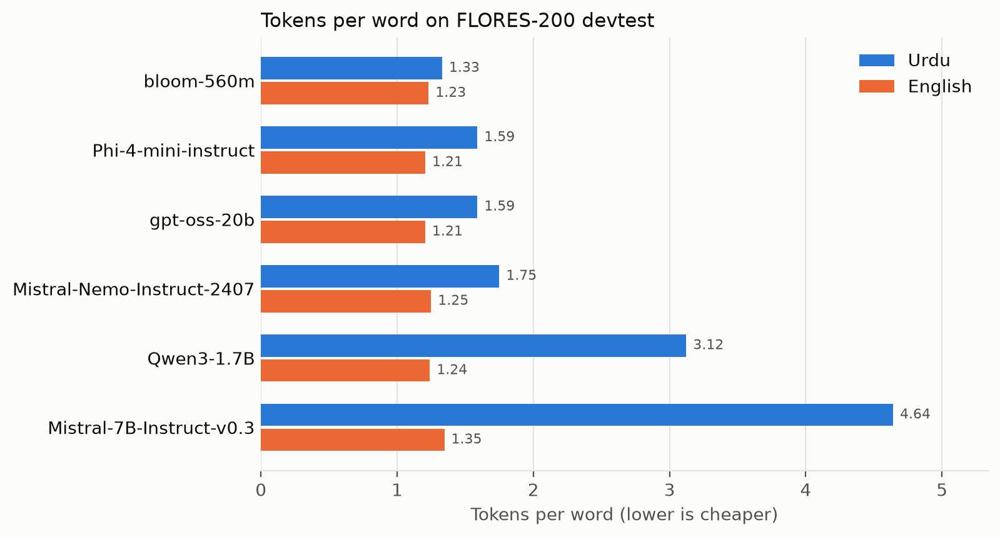
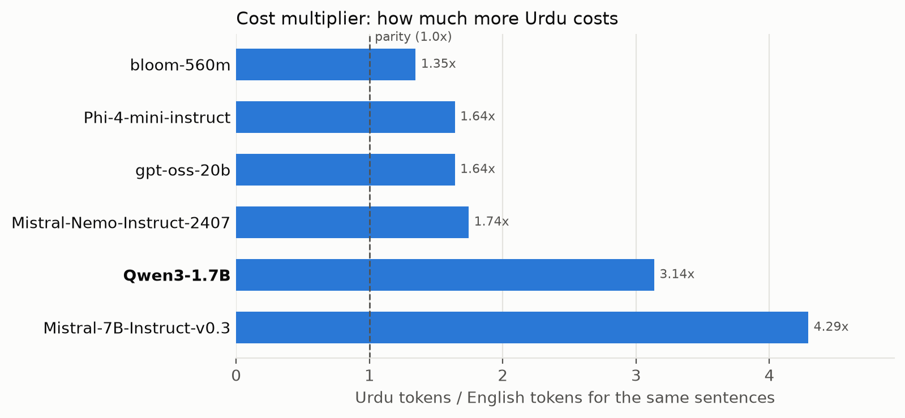
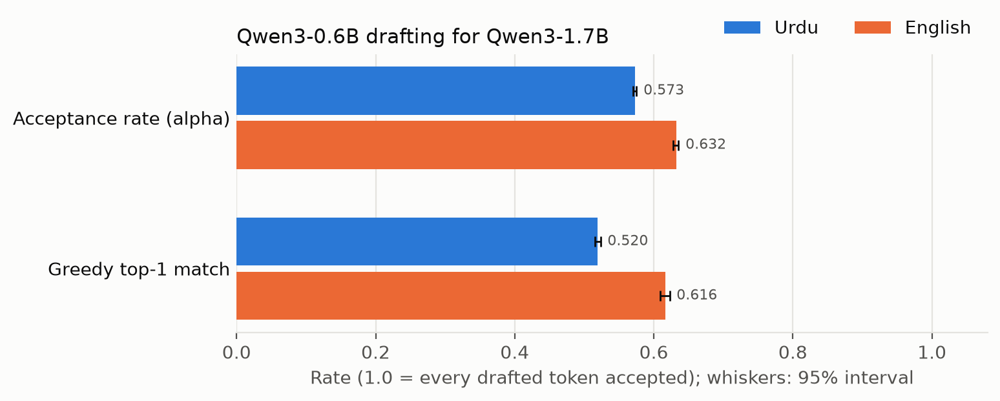

# The Urdu language tax

Open LLMs charge Urdu speakers more than English speakers for the same content: their
tokenizers split Urdu into more pieces, and the small draft models used to speed up
generation guess Urdu worse. This report measures both effects on the same parallel
sentences. It is the baseline that later zubaan stages (tokenizer extension, adaptation,
an Urdu drafter) try to improve.

## Summary

- Across 6 tokenizers, the same 1,012 sentences cost between **1.35x** (`bigscience/bloom-560m`) and **4.29x** (`mistralai/Mistral-7B-Instruct-v0.3`) as many tokens in Urdu as in English.
- `Qwen/Qwen3-1.7B`, the model zubaan extends, needs **3.12 tokens per Urdu word** against 1.24 for English. The same text costs **3.14x** as many tokens and fills the context window that much faster, and at equal tokens per second Urdu output arrives **2.5x** slower in words per second.
- Speculative decoding: the draft's guesses are accepted at alpha = **0.573** in Urdu and **0.632** in English.

## What was measured

- **Data:** FLORES-200 `devtest` from Meta's archive (SHA-256 `b8b0b7678302...`): 1,012 sentences professionally translated into Urdu
  (`urd_Arab`) and English (`eng_Latn`). License CC BY-SA 4.0. Urdu text is normalized
  (Unicode NFC, Arabic look-alike letters mapped to Urdu forms, diacritics removed) before
  counting.
- **Software:** Python 3.11.15, zubaan 0.0.1, transformers 5.22.2, tokenizers 0.23.3, huggingface_hub 2.4.0, datasets 5.2.0.
- **Machine:** Windows-10-10.0.19045-SP0. Tokenizer measurements need no GPU.
- **Words** are split on whitespace and punctuation, the same rule for both languages.

## 1. Tokenizer cost

The general formulas, over the whole corpus:

- tokens per word = total tokens / total words
- cost multiplier = total Urdu tokens / total English tokens (same tokenizer, same sentences)

For `Qwen/Qwen3-1.7B`: 86,622 Urdu tokens / 27,621 English tokens = **3.14x**. The multiplier is larger than the ratio of tokens per word because Urdu also uses more
words than English for the same sentence (postpositions such as "کا" and "میں" are separate
words).

| Tokenizer | Vocabulary | Urdu tokens/word | English tokens/word | Urdu chars/token | Cost multiplier |
| --- | ---: | ---: | ---: | ---: | ---: |
| `bigscience/bloom-560m` | 250,680 | 1.33 | 1.23 | 3.51 | **1.35x** |
| `microsoft/Phi-4-mini-instruct` | 200,029 | 1.59 | 1.21 | 2.94 | **1.64x** |
| `openai/gpt-oss-20b` | 200,019 | 1.59 | 1.21 | 2.94 | **1.64x** |
| `mistralai/Mistral-Nemo-Instruct-2407` | 131,072 | 1.75 | 1.25 | 2.67 | **1.74x** |
| `Qwen/Qwen3-1.7B` | 151,669 | 3.12 | 1.24 | 1.50 | **3.14x** |
| `mistralai/Mistral-7B-Instruct-v0.3` | 32,768 | 4.64 | 1.35 | 1.01 | **4.29x** |

Every tokenizer above is lossless on this data (no unknown tokens; every sentence decodes
back to itself), so a low count is not hiding lost text.

Not measured (access not granted at the time of the run; they will be added when it is):

- `google/gemma-3-1b-it`: OSError: You are trying to access a gated repo.
- `meta-llama/Llama-3.2-1B`: OSError: You are trying to access a gated repo.





## 2. Speculative decoding acceptance

Draft `Qwen/Qwen3-0.6B`, target `Qwen/Qwen3-1.7B`, same vocabulary (checked). Both models read
the same real sentence; at every position the acceptance rate is the overlap of their
next-token distributions. Models ran in float32 on cuda (joint mode);
x86_64.

| Language | Texts | Positions | alpha | 95% interval | Greedy match | Best gamma | Tokens per pass | Best modelled speedup |
| --- | ---: | ---: | ---: | --- | ---: | ---: | ---: | ---: |
| Urdu | 1012 | 85,610 | **0.573** | [0.570, 0.575] | 0.520 | 1 | 1.57 | 1.17x |
| English | 1012 | 26,609 | **0.632** | [0.628, 0.636] | 0.616 | 1 | 1.63 | 1.21x |

Urdu drafts are accepted less often than English ones (0.573 vs 0.632), and the 95% intervals do not overlap.



The speedup is **modelled, not measured**: speedup = E / (1 + gamma x c), where gamma is the
number of drafted tokens and E = (1 - alpha^(gamma+1)) / (1 - alpha). It is evaluated for
gamma = 1 to 6 and the table reports the best gamma for each language. It uses draft cost
c = 0.35 (parameter ratio) and assumes each drafted token is accepted
independently. A low alpha favors short drafts, so one fixed gamma understates the achievable
speedup for the language with the lower alpha.
Real speed is measured against running servers in stage 5.

### Both taxes together: words per target step

Speculative decoding is judged per target forward pass, but readers receive words. Dividing
expected tokens per pass by tokens per word gives a number that is fair across languages:

words per target step = E / tokens per word, where E = (1 - alpha^(gamma+1)) / (1 - alpha)

Each language uses its own best draft length from the table above.

| Language | alpha | Best gamma | E | Tokens per word | Words per target step |
| --- | ---: | ---: | ---: | ---: | ---: |
| Urdu | 0.573 | 1 | 1.57 | 3.12 | **0.50** |
| English | 0.632 | 1 | 1.63 | 1.24 | **1.32** |

Each expensive step of the target model delivers 2.6 times as many English words as
Urdu words.

## Limitations

- FLORES sentences are formal, encyclopedic and news-like. Conversational Urdu, code-mixed
  Urdu-English and Roman Urdu are not covered.
- Acceptance is measured with teacher forcing: both models read reference text. In real
  serving the draft continues the target's own output, which can change acceptance.
- Speedups are modelled from alpha with an estimated draft cost; they are not timings.
- One draft/target pair (Qwen3-0.6B and Qwen3-1.7B) is measured; other families may differ.
- Word boundaries are rule-based. Urdu compounds written with a space count as two words,
  which lowers Urdu tokens per word slightly; the cost multiplier does not depend on words.

## Reproduce

```
uv sync --group dev --extra audit --extra report
uv run zubaan data flores
uv run zubaan audit compare --config configs/audit-compare.yaml
uv run zubaan audit acceptance --config configs/audit-acceptance.yaml
uv run zubaan report tax
```

The full 1,012-sentence acceptance run uses `notebooks/01_audit_acceptance_qwen3.ipynb` on a
Kaggle GPU.
